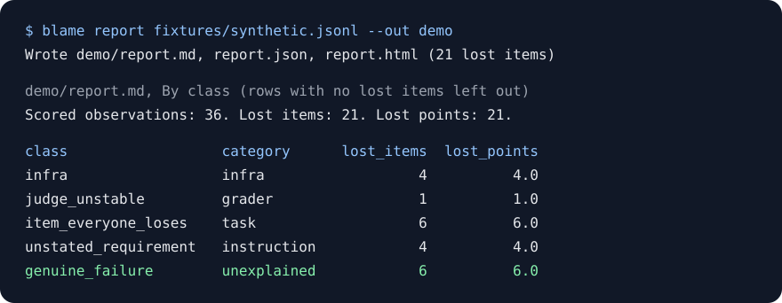

<div align="center">

# blame

### Did the model fail, or did your eval?

**Offline triage CLI for failed LLM and agent evals.** Reads generic JSONL, Inspect JSON logs, Harbor job directories and SWE-bench harness output, then labels each failure with quoted evidence and counts. No model calls.

[](LICENSE)
[](pyproject.toml)


[**Quick start**](#quick-start) · [What it found](#what-it-found) · [Why blame](#why-blame) · [What it does](#what-it-does) · [Formats](#supported-formats) · [How it works](#how-it-works) · [Sample output](#sample-output) · [FAQ](#faq) · [Docs](#documentation)

```sh
pip install git+https://github.com/harinaralasetty/blame
```

Run it inside a virtual environment. Or clone the repo and run `python3 -m blame_cli` with no install.



By [Hari Naralasetty](https://github.com/harinaralasetty) · [LinkedIn](https://www.linkedin.com/in/harinaralasetty)

</div>

> [!NOTE]
> A label is a hypothesis to check, not proof of who caused a failure. `genuine_failure` only means no rule fired.
> blame sorts what the result files already record. It never reruns a task, a grader or a model.
> The Harbor and SWE-bench readers were checked against one harness version each, on a few small runs.

## What it found

**On published Arena-Hard v0.1 results, the judge changed its preference in 500 of 1,500 answer pairs (33.3%) when the answer order was swapped.** In 268 pairs the winner reversed outright. In 232 the result moved between a tie and a win or loss. These are historical public results, not new model runs. [Read the findings and reproduction steps](realdata/FINDINGS.md).

One example: an answer used a regex without a fixed video ID length. Before the swap, the judge wrote:

> Assistant B's answer is slightly better because it does not assume a fixed length for the video IDs

After the swap, it preferred the other answer:

> Assistant B's answer is slightly better because it correctly assumes the length of the YouTube video ID

The candidate went from a win to a loss. Both explanations also noticed a real defect: neither regex targeted `href` attributes. A judge issue and a model bug can coexist. [Source example and context](realdata/FINDINGS.md#1-the-same-regex-choice-wins-then-loses).

## Why blame

A failed eval item can be the model's fault, the grader's, the task's or the infrastructure's, and a pass rate does not say which.

- **Sorts every lost point.** Each failed attempt gets one of eleven labels, with every other rule that matched listed beside it.
- **Shows its evidence.** Reports quote the error text, the scores and the judge reasoning behind each label, so you can check it.
- **Runs offline.** Python standard library only. No model API calls, no API keys, no runtime dependencies.
- **Reads four formats.** Its own JSONL, Inspect JSON logs, Harbor job directories and SWE-bench harness output, mixed in one run if you like.
- **Three report files.** Markdown, JSON and one self-contained HTML page with no scripts or external assets.
- **Measurable.** `blame label` and `blame score` report precision and recall against labels you fill in yourself.

## Quick start

**Try it** from a clone, with Python 3.11+ and nothing to install:

```sh
git clone https://github.com/harinaralasetty/blame.git
cd blame
python3 -m blame_cli report fixtures/synthetic.jsonl --out demo
```

Open `demo/report.html`. JSON and Markdown versions are beside it. This synthetic demo has 36 scored observations and 21 lost items. It is separate from the Arena-Hard result above.

**Install** the `blame` command into a virtual environment (needs internet for the build dependency):

```sh
python3 -m venv .venv
.venv/bin/python -m pip install git+https://github.com/harinaralasetty/blame
.venv/bin/blame --help
```

From a clone, `.venv/bin/python -m pip install .` does the same.

**Use** it on your own results:

```sh
blame report IN... --out DIR         # write report.md, report.json and report.html
blame label IN... --out labels.csv   # one row per lost or ungraded item, blank human_label
blame score labels.csv               # precision and recall on the rows you labelled
```

`label` leaves `human_label` blank. Fill it after reviewing the evidence, then `score` measures precision and recall on that labelled subset. It does not produce ground truth for you.

<details>
<summary><b>Flags, install names and edge cases</b></summary>

<br>

- `--format auto|generic|harbor|inspect|swebench`: the reader for every `IN`. The default `auto` detects the format per input, so inputs may mix formats.
- `./blame` in a clone, `python3 -m blame_cli` and the installed `blame` command are the same program.
- `pip install blame` does **not** install this project. The PyPI project named `blame` belongs to another tool. This project is not on PyPI. Its distribution name is `blame-cli` and its console command is `blame`.
- On Windows the venv commands live at `.venv\Scripts\python.exe` and `.venv\Scripts\blame.exe`.
- Errors return status 2 with the input path and, for JSONL, the line number. Files are read before any report is written.
- Hand-written fixtures show the Harbor and SWE-bench shapes: `./blame report fixtures/harbor-job --out demo-harbor` and `./blame report fixtures/swebench-eval --out demo-swebench`. `make demo` builds all four demo reports.
- Reports copy error messages, test output, log lines and patches from the result files. Absolute home-directory paths in that text are shortened to `~`, error text is cut after 2,000 characters and a patch after 20,000. Nothing else is removed, so read a report before sharing it.
- Each generic record describes one task, model, generation run, rubric item, output, score in [0,1] and judge reasoning. Optional judge IDs identify repeated judgments of the same generation. Optional keys can name the agent, mark a reference-solution run, carry the harness error class and mark an attempt as never graded (`score: null`).

</details>

## What it does

Each failed attempt gets the first label that matches, in this order. Every other match is kept in the report.

| Label | Category | Fires when |
| --- | --- | --- |
| `infra` | infra | The harness recorded an infrastructure error, or the output is shaped like a timeout, rate limit, HTTP 5xx or missing artifact |
| `setup_error` | setup | The harness classified the error as setup |
| `grader_error` | grader | The harness classified the error as a grader error |
| `judge_unstable` | grader | Two or more gradings of the same output disagree |
| `reference_flaky` | grader | The reference solution passed on some attempts and failed on others |
| `reference_fails` | task | The reference solution failed and never passed |
| `item_everyone_loses` | task | Two or more systems tried the item and none scored above zero |
| `unstated_requirement` | instruction | The rubric requires a literal term the instruction never mentions |
| `attempts_flip` | unexplained | Another attempt of the same system on the same task passed |
| `unclassified_error` | unexplained | The harness error class is unknown, or an agent error left the attempt ungraded |
| `genuine_failure` | unexplained | No rule matched |

Each label has a fixed rule strength between 0.40 and 0.99. These are not calibrated probabilities. The exact predicates and strengths are in the [reference](docs/reference.md#labels).

## Supported formats

| Input | What to pass | Status |
| --- | --- | --- |
| Generic JSONL | a `.jsonl` file | tested on synthetic fixtures and the public Arena-Hard conversion |
| Inspect v2 text JSON | a log from `inspect eval --log-format json` | a documented subset; fixture hand-written, not validated by `inspect_ai` |
| Harbor | a trial directory, a job directory or a directory of jobs | checked against real output of Harbor 0.24.0 (`fixtures/real-harbor`) |
| SWE-bench harness | the directory the harness ran in, its `logs/run_evaluation`, or one run directory | checked against real output of swebench 5.0.2 (`fixtures/real-swebench`) |

Not supported: binary Inspect `.eval` files, tool-only outputs and the SWE-bench public submissions layout.

<details>
<summary><b>What "checked against real output" means</b></summary>

<br>

The Harbor and SWE-bench readers were written from the harness source code and then checked against a few small real runs: one harness version each, on local Docker. The runs and commands are in [`fixtures/real-harbor/README.md`](fixtures/real-harbor/README.md) and [`fixtures/real-swebench/README.md`](fixtures/real-swebench/README.md).

Most harness error classes were not produced in those runs, so check a report against your own files before relying on it. The field-by-field mappings and the known limitations are in the [reference](docs/reference.md).

</details>

## How it works

1. **Read.** One reader per format turns each input into plain records: task, system, run, rubric item, output, score, judge reasoning and any recorded error.
2. **Detect.** Deterministic rules run over the records. Some look at one record (an error the harness wrote down). Others compare records (two gradings of one output, reference runs, every system on one item).
3. **Pick a verdict.** The first match in the label order becomes the verdict. All matches stay in the report.
4. **Report.** The same data is written as Markdown, JSON (`schema_version: 2`) and static HTML, grouped by class, by system and by task, with a next step to check for each failed task.

<details>
<summary><b>Source layout</b></summary>

<br>

- `blame_cli.cli` implements the report, label and score commands.
- `formats` holds one reader per input format; `inputs` and `model` validate the records.
- `detectors` applies deterministic rules and preserves overlapping matches.
- `Reasoner.missing_requirements` is the pluggable interface for a future LLM; the shipped implementation uses heuristics only.
- `reports` renders JSON, Markdown and self-contained HTML; `labels` handles CSV and label metrics.
- `adapters/arena_hard.py` converts published comparisons; `realdata/` keeps provenance and audited extracts.
- `tests` uses standard-library unittest; fixtures are synthetic or public.

</details>

<details>
<summary><b>Assumptions</b></summary>

<br>

- Scores below 1 mean lost credit. Each judge observation is counted separately; repeated judging is not another generation attempt. Arena-Hard scores map relative preferences to win=1, tie=0.5, loss=0, not rubric correctness or leaderboard scores.
- Task, rubric, model and run IDs are comparable across supplied inputs. Judge instability needs explicit distinct judge IDs with unchanged generation, instruction and rubric. Missing models and runs cannot be inferred.
- Instructions include all requirements needed to assess the rubric. A nonempty error field with no `error_kind` represents an active failure.
- Inputs and reports fit in memory. This is a tool for local text eval review.
- There are no runtime or test dependencies. `setuptools>=77` is the sole build dependency: it builds the wheel, installs the console script and supports the MIT license metadata. pip supplies it in an isolated build environment.

</details>

## Sample output

From `demo/report.md`, written by the Quick start command on the synthetic fixture:

| task_id | systems_attempted | systems_failed | primary_label | rule strength | labels | next_step |
| --- | --- | --- | --- | --- | --- | --- |
| availability:sample | 3 | 2 | infra | 0.95 | infra 4, judge_unstable 1 | Rerun the attempt after checking the recorded error or output. |
| color:sample | 3 | 3 | item_everyone_loses | 0.90 | item_everyone_loses 6, genuine_failure 2 | Check the task and its checks against a known-good solution. |
| greeting:sample | 3 | 2 | unstated_requirement | 0.65 | unstated_requirement 4, genuine_failure 4 | Check whether the instruction states what the rubric requires. |

The `reference` and `category` columns are left out here to fit the page.

From the real Arena-Hard run (3,000 scored observations, 1,826 lost), as kept in [`realdata/arena_hard/report.md`](realdata/arena_hard/report.md):

| class | lost_items | lost_points |
| --- | --- | --- |
| infra | 0 | 0 |
| judge_unstable | 606 | 490.0 |
| item_everyone_loses | 204 | 204.0 |
| unstated_requirement | 0 | 0 |
| genuine_failure | 1016 | 915.0 |

That report predates the six labels added in 0.2.0.

**[Preview a trimmed real HTML report](docs/report.html)**: download it and open it locally. It holds the full-run tables and one audited example, with expandable evidence. GitHub's file view shows the HTML source.

## What blame does not do

blame narrows down where to look. It does not settle who is at fault.

<details>
<summary><b>The eight limits, in full</b></summary>

<br>

- **Prove who caused a failure.** Attribution is a hypothesis to check. `genuine_failure` is the schema's default label for an unclassified loss, not proof of model responsibility.
- **Establish real-world precision or recall.** Codex checked 20 fired verdicts: 12/12 disagreement flags and 8/8 cohort-loss flags matched their documented predicates. This was not independent human annotation. Default cases were not audited; no recall or eval-fault attribution precision was measured.
- **Diagnose positional bias from a swap alone.** Order changed between the two games. The result does not separate position effects from other judge variability or identify the correct winner.
- **Prove an eval item is wrong because everyone loses.** The run found 34 such prompts across three supplied candidates; GPT-4 0314 was their fixed comparator and was excluded from the scored cohort. Shared losses can reflect real candidate defects.
- **Say a task is broken, a grader is flaky or a model is at fault.** Result files support narrower statements: the harness recorded an error of a given type, two gradings of one output disagree, the reference solution did not pass or passed only sometimes, no supplied system scored above zero, a system both passed and failed a task. A flip between two attempts of a stochastic agent is not evidence about the grader. An `infra` label is only as right as the harness's record or its log heuristic.
- **Separate a real model failure from a reference problem.** When the reference fails on a task, that fact becomes the headline of every failed attempt on it, including attempts that failed on their own account.
- **Run anything.** blame never reruns a reference solution or a do-nothing agent. Run those with the harness and pass the result directories in; reference runs are read.
- **Understand requirements semantically or calibrate confidence.** The shipped reasoner checks literal anchors and abstains on some ambiguous wording. Confidence values are fixed heuristic strengths, not probabilities of correct attribution.

</details>

## FAQ

**Does it call a model or need an API key?** No. It uses the Python standard library only and makes no network calls. The one build dependency is `setuptools`, which pip fetches at install time.

**Does `genuine_failure` mean the model was wrong?** No. It means no rule fired. It is the default label, not a finding.

**Several rules matched one failure. Which label wins?** The first one in the label order under [What it does](#what-it-does). The others are listed in the report as detector matches.

**How do I find LLM judge flips in my own eval?** Give each repeated grading of the same output a distinct `judge_run` in the generic JSONL. `judge_unstable` reports outputs whose gradings disagree. For SWE-bench, pass two run directories that graded the same patch.

**How do I check for a broken task?** Run the task's reference solution with your harness and pass those results in too. Harbor's `oracle` agent and SWE-bench's `gold` predictions are read as reference runs. blame then reports `reference_fails` or `reference_flaky`.

**Can I `pip install blame`?** No. That PyPI name belongs to a different tool. Install from GitHub or run from a clone.

**Is it safe to share a report?** Read it first. Reports quote your result files. Only absolute home-directory paths are shortened.

## Where this fits

Use blame after an eval run, before you trust the pass rate or file a bug against a model.

- [Inspect](https://inspect.aisi.org.uk/), [Harbor](https://github.com/harbor-framework/harbor) and the [SWE-bench harness](https://github.com/SWE-bench/SWE-bench) run the evals. blame reads what they wrote.
- Harbor's own `harbor analyze` has a model read each trial against a rubric. blame makes no model calls and only sorts what the result files already record.

## Documentation

- [Input schema, format mappings, labels and known limitations](docs/reference.md)
- [Arena-Hard findings and reproduction steps](realdata/FINDINGS.md)
- [Real Harbor output used for checking](fixtures/real-harbor/README.md) and [real SWE-bench output](fixtures/real-swebench/README.md)
- [Independent check of the cross-format readers](docs/CHECK-cross-format.md)
- [Changelog](CHANGELOG.md)

## Contributing

Use Python 3.11+ and Make. The test suite is standard-library `unittest` and needs no install:

```sh
make test
```

Keep it dependency-free: no runtime or test dependencies. Fixtures must be synthetic or public. Report bugs through [GitHub Issues](https://github.com/harinaralasetty/blame/issues), with result files you are free to share.

## License

Code: [MIT](LICENSE), Copyright (c) 2026 Hari Naralasetty. The public Arena-Hard extracts retain their [Apache-2.0 license](realdata/arena_hard/LICENSE) and [source attribution](realdata/arena_hard/NOTICE.md). The HTML preview is a derived extract of the same public data.
