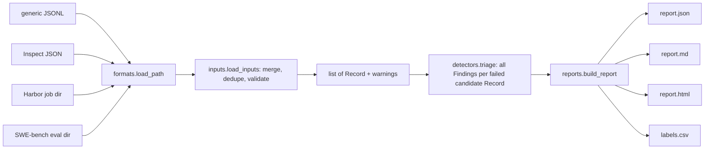

# Plan: cross-format verdicts backed by evidence (v0.2)

Status: plan only, revision 2 (after the review in `docs/PLAN-cross-format-REVIEW.md`). No code in this document has been written. Baseline: `main` at `ce0a271`.

## 1. Current state

**What exists.** A dependency-free Python 3.11+ CLI (`blame report|label|score`), 683 source lines in `blame_cli/`, 45 tests. It reads generic JSONL and a subset of Inspect v2 text JSON, runs four deterministic detectors plus a default, and writes `report.json`, `report.md`, `report.html` and a labelling CSV. `adapters/arena_hard.py` is a separate study script that converts Arena-Hard v0.1 to generic JSONL; `realdata/` keeps the audited extract.

**Check command and result today.** `make test` (`python3 -m unittest discover -s tests -v`): `Ran 45 tests, OK` on Python 3.15.2. CI runs the same on 3.11 to 3.13. `realdata/FINDINGS.md:235` still says 33 tests (stale, fix in M1).

**Strengths to keep.**
- One flat, validated record type; detectors are pure functions; overlapping matches are kept in `matches`, so a grader issue and a model bug can coexist.
- Careful wording: every label is a hypothesis, confidences are fixed strengths, `genuine_failure` is a default.
- Stable `record_id` hash ties labels to exact inputs; HTML is script-free and escaped; no runtime dependencies.

**Structural problems.**
| # | Problem | Where |
| --- | --- | --- |
| P1 | Format sniffing, two parsers and cross-file validation live in one function; inputs must be files, so result directories cannot be read; no way to force a format | `blame_cli/inputs.py:122-166` (sniff 137-139, `read_text` 131) |
| P2 | `Record` requires non-empty `instruction`, `rubric_item_text` and a numeric score, so it cannot hold an attempt that was never graded or a format without instruction text | `blame_cli/model.py:33-45` |
| P3 | No notion of agent, reference run or error class. Any non-empty `error` is infra at 0.99 | `model.py:16-27`, `detectors.py:27-29` |
| P4 | Precedence is encoded three times | `detectors.py:167-171`, `model.py:9-12`, `labels.py:85` |
| P5 | `triage` hardcodes the detector list and builds indexes inline; `item_everyone_loses` rescans its group per record | `detectors.py:155-179`, `detectors.py:75` |
| P6 | No per-task view and no "what to check next"; `scored_items = len(records)` assumes every record has a score | `reports.py:27`, `reports.py:58-68` |
| P7 | `detectors.infra` calls `record.output.strip()`, which raises on `output=None` | `detectors.py:31`, `detectors.py:34` |
| P8 | No `CHANGELOG.md`; stale test count | repo root, `realdata/FINDINGS.md:235` |

**Verdict on restructuring.** No rewrite: the record type, detectors, reports and label scoring are sound and tested. A small restructure comes first (P1, P4): move the two parsers into a format package behind a registry and make one label table the only source of precedence. That is M1, a pure move with byte-identical output and no test edited. Everything else is additive in later milestones. Top-level `adapters/`, `realdata/`, `fixtures/` stay where they are; gitignored local outputs (`demo/`, `data/`, `validation/`) are left alone.

## 2. Target architecture

```
blame_cli/
  model.py            Record, Finding, LabelInfo, LABELS, CLASSES, record_dict, validate   (imports nothing local)
  formats/__init__.py registry, detect_format, load_path, redact                           (model)
  formats/generic.py  generic JSONL                                                         (model)
  formats/inspect_json.py  Inspect v2 text JSON, moved verbatim                             (model)
  formats/harbor.py   Harbor job and trial directories                                      (model)
  formats/swebench.py SWE-bench harness evaluation directories                              (model)
  inputs.py           load_inputs: loops paths, per-format merge, dedupe, cross-file checks; re-exports inspect_records
  detectors.py        existing detector functions (signatures unchanged), Index, new detectors, DETECTORS, triage
  reports.py          build_report, markdown, static_html, write_report                     (detectors, model)
  labels.py           CSV export and scoring                                                (model)
  cli.py              argparse only                                                         (inputs, reports, labels)
adapters/arena_hard.py   unchanged study converter (network, not installed)
```

Dependency direction: `formats -> model <- detectors <- reports <- cli`. Nothing imports `cli`; `formats` never imports `detectors` or `reports`. The package is `formats` so the existing top-level `adapters/` path stays valid.

```python
# model.py
def record_dict(record: Record) -> dict          # v1 keys always; v2 keys only when non-default
def validate(record: Record) -> Record           # raises ValueError; used by non-generic readers
# formats/__init__.py
FORMATS = ("harbor", "swebench", "inspect", "generic")            # detection order
def detect_format(path: Path) -> str             # raises ValueError naming every probe tried
def load_path(path: Path, fmt: str = "auto") -> tuple[list[Record], list[str]]
def redact(text: str) -> str                     # home-directory prefixes -> "~"
# each formats/<name>.py
def detect(path: Path) -> bool
def load(path: Path) -> tuple[list[Record], list[str]]            # (records, warnings)
def merge(records: list[Record]) -> tuple[list[Record], list[str]]   # optional; once over all inputs of this format
# inputs.py
def load_inputs(paths: Iterable[str], fmt: str = "auto") -> tuple[list[Record], list[str]]
# detectors.py: infra(record), judge_unstable(record, peers), item_everyone_loses(record, peers),
#               unstated_requirement(record, reasoner) keep today's signatures. Added in M3:
def build_index(records: Sequence[Record]) -> Index              # groups built once
DETECTORS: tuple[tuple[str, Callable[[Record, Index, Reasoner], Finding | None]], ...]   # LABELS order
def triage(records, reasoner=None) -> list[dict]                 # same item shape
```



## 3. Neutral data model (schema version 2)

Decision: keep one flat record per graded check and extend it. Every detector groups by key, and nesting would change `record_id` and break label files. Jobs, tasks and attempts are keys, not containers.

```python
@dataclass(frozen=True)
class Record:                       # one graded check of one attempt
    task_id: str                    # v1
    model: str                      # v1; may be "" only when agent is set
    run_id: str                     # v1; identifies ONE attempt (generation, trial, epoch, patch)
    instruction: str | None         # v1; None = the format does not carry it
    rubric_item_id: str             # v1; the check: rubric item, "reward" or "resolved"
    rubric_item_text: str | None    # v1
    output: str | None              # v1; None = not carried; "" = known empty
    score: float | None             # v1; None = never graded (requires error)
    judge_reasoning: str            # v1; grader note
    judge_run: int | None = None    # v1; repeated grading of the SAME output
    error: str | None = None        # v1
    agent: str | None = None        # v2
    role: str = "candidate"         # v2; "candidate" | "reference"
    error_kind: str | None = None   # v2; "infra" | "setup" | "grader" | "agent" | "unknown"
    task_version: str | None = None # v2; task checksum, if the format gives one
    job_id: str | None = None       # v2; the job or harness run this attempt belongs to

    system      -> " / ".join of agent and model that are set; equals model for v1 data
    item_key    -> (task_id, rubric_item_id)          # unchanged
    attempt_key -> (task_id, system, run_id)
    judge_key   -> unchanged 7-tuple
    record_id   -> sha256(json(record_dict(self)))    # identical to today for v1 data
```
`Finding(label, confidence, evidence)` is unchanged. `LabelInfo(name, category, next_step)`; `LABELS` in precedence order is the only precedence source and `CLASSES` is derived from it.

Rules. `Record.from_dict` (generic JSONL) keeps today's checks, accepts the five optional v2 keys (null or absent means default), and accepts `score: null` only with a non-empty `error`. `validate` (other readers): non-empty `task_id`, `run_id`, `rubric_item_id`; `model` or `agent` non-empty; score `None` or finite in [0,1]; `score is None` requires `error`; `role` and `error_kind` from the sets above. `load_inputs` rejects records that share an `attempt_key` but differ in `error_kind`.

`error_kind`: `infra` = sandbox, network or provider fault; `setup` = the run was misconfigured or stopped (credentials, unknown model, rejected request, budget, cancellation); `grader` = the verifier failed to produce a result; `agent` = the harness counts this result as a valid failure (it does not mean the agent caused it); `unknown` = an error the format does not classify; `None` = v1 behaviour (non-empty `error` is infra).

| Concept | Representation |
| --- | --- |
| Job / harness run | `job_id` |
| Task | `task_id`, guarded by `task_version` |
| Attempt | `attempt_key`; records sharing it are checks or re-gradings of one attempt |
| System under test | `system` (agent + model) |
| Reference solution run | `role == "reference"` |
| Verdict | highest-precedence `Finding`; all findings kept in `matches` |
| Evidence | `Finding.evidence`, JSON-serialisable |

Compatibility of ids: Inspect records keep `job_id=None` (setting it would change every existing Inspect `record_id`).

## 4. Adapter contract and mappings

Contract. `load(path)` returns records in deterministic order (sorted walks) plus warnings. It never invents a score: no grade means `score=None` plus `error`. It raises `ValueError` on structurally invalid input and reads only local files. It never reads Harbor `config`, `trial_uri` or `exception_traceback`. Text it does copy (error messages, test-output tails, log tails, patches) passes through `redact`, which replaces `/Users/<name>`, `/home/<name>` and `C:\Users\<name>` prefixes with `~`; everything else is verbatim, and the README says to review a report before sharing it.

**Auto-detection** (`--format auto`, default; `--format NAME` applies to every `IN`). First match wins:
1. Directory: `harbor` if a `result.json` at depth 0, 1 or 2 is an object with `trial_name` and `agent_info` (so a trial dir, a job dir, or a directory of jobs all work). Else `swebench` if a `report.json` at depth 2 or 3 has exactly one top-level key, equal to its parent directory name, whose value has `resolved`. Else an error naming both probes.
2. File ending `.eval`: error, as today. 3. One JSON object: `generic` if it has `task_id`, else `inspect` if it has `eval` or `samples` (unchanged). 4. Otherwise `generic` JSONL.

Partial data: an unreadable result file is skipped with one warning; an input with zero readable results is an error; mixed formats across `IN...` are allowed.

**Generic JSONL, Inspect, Arena-Hard**: mappings unchanged. Inspect fields were re-read at `UKGovernmentBEIS/inspect_ai@8012060c` (`src/inspect_ai/log/_log.py`, `scorer/_metric.py`). Arena-Hard stays a converter to generic JSONL.

**Harbor** (`harbor-framework/harbor@3ee9f53e6b459712fdec4e8ce6613d7aa5610299`: `src/harbor/models/trial/result.py`, `trial/paths.py`, `trial/error_policy.py`, `verifier/result.py`, `agent/name.py`, `trial/trial.py`). Only `<trial_dir>/result.json` (a serialised `TrialResult`) and `<trial_dir>/verifier/test-stdout.txt` are read. One record per trial.
| Harbor field | Record field |
| --- | --- |
| `task_name` (no `source` prefix, so local and registry runs join) | `task_id` |
| `task_checksum` | `task_version`; warn when one `task_id` has more than one |
| `agent_info.name` | `agent`; `role="reference"` if `oracle`; a `nop` trial is skipped with a warning |
| `agent_info.model_info.provider` + `/` + `.name` (provider optional) | `model` (`""` when absent) |
| name of the directory holding the trial directory | `job_id` |
| `trial_name` + `@` + first 8 characters of `id` | `run_id` |
| `verifier_result.rewards["reward"]`; if absent and exactly one key exists, that key | `rubric_item_id="reward"`, `score`. Other keys are listed in `judge_reasoning`, never scored |
| no rewards, no usable key, or a value outside [0,1] | `score=None`, `error` says which, `error_kind="unknown"` unless an exception sets it |
| `exception_info`, else the first `step_results[].exception_info`: `exception_type`, `exception_message` | `error = "Harbor <type>: <message>"` |
| `exception_type` looked up in the name table below | `error_kind` |
| `exception_info.policy_override.has_valid_reward` when set | `true` -> `agent`; `false` on an `agent` name -> `unknown`; the override is quoted in `error` |
| reward usable? first present of: `reward_valid`, `exception_info.policy.has_valid_reward`, the table (unlisted name = usable, Harbor's default) | not usable -> `score=None` |
| `verifier/test-stdout.txt`, last 2,000 characters | `judge_reasoning` |
| not in `result.json` | `instruction`, `rubric_item_text`, `output` = `None` |

Name table (copied from `error_policy.py` at the pinned commit; the same answer for every file, whatever its age):
- `agent` (Harbor counts the reward): `NonZeroAgentExitCodeError`, `AgentTimeoutError`, `ContextWindowExceededError`, `OutputTokenExceededError`, `ContextLengthExceededError`, `OutputLengthExceededError`, `AgentSafetyRefusalError`, `ContentPolicyViolationError`.
- `grader`: `VerifierTimeoutError`, `RewardFileNotFoundError`, `RewardFileEmptyError`, `VerifierOutputParseError`.
- `infra`: the twelve sandbox names (`EnvironmentStartTimeoutError` to `DownloadVerifierDirError`), the sixteen provider and network names (`ApiError` to `Timeout`), and `APIResponseValidationError`.
- `setup`: `UnsupportedModelParametersError`, `BadRequestError`, `UnprocessableEntityError`, `UnsupportedParamsError`, `BudgetExceededError`, `AgentAuthenticationError`, `ModelNotFoundError`, `ApiProviderResourceNotFoundError`, `AgentVersionTooOldError`, `AuthenticationError`, `PermissionDeniedError`, `NotFoundError`, `ServiceOperationsUnsupportedError`, `VercelScopeError`, `DspyImportError`, `MissingExtraError`, `CancelledError`.
- `unknown`: `RegradeError` (meaning unverified) and every name not in the table.

`merge` for Harbor: the same `run_id` under two `job_id`s is one trial read twice; keep the first and warn. Retried trials reuse the trial name and replace the earlier attempt, so attempts in a job are distinct trials, never retries (documented).

**SWE-bench** (`SWE-bench/SWE-bench@02e7a74ffd0b707aab73d203fe87bdc7c76afc8e`: `swebench/harness/grading.py`, `run_evaluation.py`, `reporting.py`, `infra_failure.py`, `constants/__init__.py`, `utils.py`). Harness layout only: `<run_id>/<model_dir>/<instance_id>/{report.json, patch.diff, run_instance.log}` and the run summary `<run_id>/results.json`. `IN` is one run directory or a directory of run directories.
| SWE-bench source | Record field |
| --- | --- |
| report key / instance directory name | `task_id` |
| `<model_dir>` name | `model`; `role="reference"` when it is `gold` |
| the layout's `<run_id>` directory name (from the resolved path, never the raw argument) | `job_id` |
| `patch:` + first 12 hex of sha256 of `patch.diff`; `job_id` when the file is missing (warning) | `run_id` |
| `patch.diff` | `output` |
| constant; `resolved` | `rubric_item_id="resolved"`; `score` 1.0 or 0.0 |
| `infra_failure == true` with `infra_failure_reason` | `error_kind="infra"`, `error="SWE-bench log pattern: <reason>"` |
| `infra_failure_reason` set, `infra_failure == false` | `error_kind="unknown"`, same `error` text |
| `patch_exists`, `patch_successfully_applied`, `tests_status` counts and up to 20 failed test names per group | `judge_reasoning`; `patch_successfully_applied == false` is worded "no parseable test output" |
| `results.json` `empty_patch_ids` | record with `output=""`, `score=0.0`, `error="empty patch"`, `error_kind="agent"`, `run_id="patch:empty"` (the harness counts it submitted and not resolved) |
| `results.json` `error_ids`, or an instance directory, without `report.json` | `score=None`, `error` = last 5 lines of `run_instance.log` (or "no report.json"), `error_kind="unknown"` |
| `results.json` `incomplete_ids` | one warning with the count |
| no `results.json` | warning: empty patches and harness errors are not visible |
| not in results | `instruction`, `rubric_item_text`, `agent`, `task_version` = `None` |

Summary ids are attributed to a model only when the run has one model directory or the instance directory exists; otherwise they are skipped with a warning. `merge` for SWE-bench: records with the same `attempt_key` (same instance, model and patch) from different `job_id`s are re-gradings of one output and get `judge_run` 1..n in `job_id` order, so the existing `judge_unstable` detector reports a flip.

## 5. Detectors

Only failed candidate records are triaged (`score is None or score < 1`, `role == "candidate"`). Each detector returns at most one `Finding`; all are kept in `matches`; the first in `LABELS` order is the headline. Attempts with `error_kind` in `infra`, `setup`, `grader`, or with a v1 `infra` finding, are left out of every cross-attempt comparison and count as no evidence, never as failures. `unknown` and `agent` attempts stay in; records with `score=None` never count as a pass or a fail.

| Label (precedence order) | Category | Rule | Evidence | Strength | Known false positives |
| --- | --- | --- | --- | --- | --- |
| `infra` | infra | `error_kind is None` and non-empty error, or an `INFRA_RULES` match on a string `output` (today's rules); `error_kind == "infra"` | rule, error or output quote, the heuristic named in the error text | 0.99 (v1 rules, unchanged); 0.80 | an answer that is only an error phrase; memory or network patterns caused by the attempt itself |
| `setup_error` | setup | `error_kind == "setup"` | error text | 0.85 | a provider outage reported as a bad request |
| `grader_error` | grader | `error_kind == "grader"` | error text | 0.85 | the attempt damaged the environment so the verifier could not run |
| `judge_unstable` | grader | unchanged (same output, two or more `judge_run`, scores disagree) | unchanged | 0.99 | order sensitivity when the repeat swaps order |
| `reference_flaky` | grader | reference attempts on this `item_key` include a pass and a scored failure | reference run ids, scores | 0.85 | a non-deterministic reference solution |
| `reference_fails` | task | one or more scored reference failures, no reference pass, and `task_version` not different from the record's | reference system, attempts, scores, version status | 0.90 with two or more failures; 0.75 with one; capped at 0.60 when either version is unset ("task version not available") | the reference solution is the broken part; a reference run on another dataset revision |
| `item_everyone_loses` | task | unchanged, over scored candidate records only; abstains when the cohort has more than one `task_version` | unchanged, plus system count | 0.90 for v1-shaped records (no v2 field set); otherwise 0.50 for 2 systems, 0.70 for 3 or 4, 0.90 for 5 or more | a hard but fair task; a weak cohort |
| `unstated_requirement` | instruction | unchanged; abstains when `instruction` or `rubric_item_text` is `None` | unchanged | 0.65 | paraphrased requirements |
| `attempts_flip` | unexplained | this record has a score below 1 and another attempt of the same `system` on the same `item_key` scored 1 | passes, attempts, run ids | 0.40 | attributes nothing by design |
| `unclassified_error` | unexplained | `error_kind == "unknown"` | raw error text | 0.40 | none as a fact; it attributes nothing |
| `genuine_failure` | unexplained | default | score, quotes, `error` if any (so `agent` errors show here) | 0.50 | everything the detectors cannot see |

Choice for `unknown`: its own label just above the default, rather than `genuine_failure` evidence, because the next step differs (read the recorded error) and it must stay countable in the per-task table. It never fires `infra` and never removes an attempt from a comparison.

Wording rules, enforced by golden tests. Every label sentence starts from the observed fact ("No supplied system scored above zero (N systems)", "The reference solution did not pass in M of M attempts", "This system passed K of N attempts"). No output says "broken test", "bad task", "flaky grader" or "model at fault". Every `next_step` is an instruction to check ("Rerun the reference before scoring systems on this task"). Confidence is shown as "rule strength" with a one-line legend, never as a probability. A label taken from a harness heuristic names it ("Harbor error policy", "SWE-bench log pattern").

**What results alone support.** The harness recorded an error of a given type; two gradings of the same output disagree; the reference solution did not pass, or passed only sometimes; no supplied system scored above zero; a system both passed and failed the same task.

**What results alone cannot support.** That the model is at fault (`genuine_failure` is an unexplained default). That a task is unfair because every system failed it. That an instruction is ambiguous (neither new format carries the instruction, so `unstated_requirement` never fires on them). That a flip between two attempts of a stochastic agent is grader flakiness. That a test is over-strict. That an `infra` label is right beyond what the harness or its log heuristic recorded. A reference label is a fact about the task and becomes the headline of every candidate failure on it, including real model failures; the per-task table says so.

**Execution checks (not built).** Reference passes N times; a do-nothing agent passes. These need Docker. Extension point: run them with the harness itself and pass the result directories to `blame`; reference runs are already read.

## 6. CLI and report changes

- `blame report IN... --out DIR [--format auto|generic|inspect|harbor|swebench]`; `label` gets the same flag; `IN` may be a directory. Exit codes and messages for existing inputs are unchanged. The `--format` help text marks `harbor` and `swebench` "unverified against real harness output" until M7.
- Schema 2 is a compatible extension for v1 inputs, not a superset. For a v1 input: `by_class` filtered to the five v1 names in v1 order, `by_model` rows restricted to v1 keys, items restricted to v1 keys, and all v1 top-level values except `schema_version` equal the v1 report. What grows: `by_class` from 5 rows to 11, each `by_model` row and the `blame score` output (`per_detector`, `per_verdict`) by 6 label keys.
- Counting. Only candidate records are counted. `scored_items` = records with a score; `ungraded_items` = records with `score=None`; `lost_items` = scored records below 1; `lost_points` = sum of `1 - score` over scored records. `items` lists lost and ungraded records (ungraded ones carry their error and `score: null`). The `counting` sentence gains "N attempts were never graded and are listed as ungraded." only when N > 0. Reference records are counted in a new top-level `reference_items` and appear only in `by_task` and in evidence.
- `by_model` groups by `system`; the row key stays `model` and holds the system string (agent + model for Harbor, identical to today for v1 data).
- New: top-level `ungraded_items`, `reference_items`, `by_task`; `by_class[].category`. `by_task` row: `task_id`, `systems_attempted`, `systems_failed`, `reference` ("passed n of m attempts" or "no reference run supplied"), `labels` (count of every finding, not only headlines), `primary_label`, `category`, `max_confidence`, `next_step`. `next_step` appears only here. Rendered as a "Failed tasks" table before the drill-down; `None` fields render as "not available in this format".
- `labels.csv`: same columns; `original_record_json` uses `record_dict`, so v1 rows are byte-identical; `human_label` accepts the eleven labels; old label files still score.
- Behaviour changes for existing users (changelog): generic JSONL reads the optional v2 keys; any input with repeated runs of one model on an item, including Inspect logs with epochs (`run_id/epoch-N`), can get `attempts_flip` as the headline instead of `genuine_failure`.

## 7. Test strategy

- One check: `make test` (stdlib `unittest`; no new dependency, network or Docker). Add Python 3.14 to CI.
- Existing tests that change, and nothing else in `tests/test_*.py`:
  - M2: `tests/test_review_round1.py:56` compares the CSV record with `asdict(record)`; it becomes `record_dict(record)` because `Record` gains fields with defaults. The `asdict(rec())` round-trips in `test_inputs.py` and `test_review_round1.py` keep passing unedited since `from_dict` accepts default v2 values.
  - M3: `tests/test_workflow.py:30-31` zips `CLASSES` with five counts; it becomes an explicit five-name mapping plus zero for the six new labels.
- Fixtures. Each has a `README.md` whose first line is "Hand-written from source reading at commit X, not harness output", with no third-party data:
  - `fixtures/v2.jsonl` (M3): generic records exercising every new field and label, including `score: null`.
  - `fixtures/harbor-job/` (M4): 2 tasks x (`oracle`, two agents), covering pass, fail, oracle fail, oracle flip, each `error_kind`, an unlisted exception with and without `policy`, `policy_override`, extra reward keys, no `reward` key, a `nop` trial, a message containing a home path, one unreadable `result.json`.
  - `fixtures/swebench-eval/run-a`, `run-b` (M5): `gold` and one model, 4 instances, covering resolved, unresolved, log-pattern infra, ambiguous reason, empty patch and error id from `results.json`, a missing `patch.diff`, and one same-patch regrade that flips between the runs.
- Goldens. `tests/golden/v1/{synthetic,inspect}.report.json` and `synthetic.labels.csv` are produced from untouched `ce0a271` code in M1 and never regenerated; exact match in M1, the section 6 projection from M2. `tests/golden/{v2,harbor,swebench}.report.{json,md}` are full comparisons, rewritten only with `UPDATE_GOLDEN=1 make test`.
- Unit tests: detection (including a jobs parent directory, and an unrelated `report.json` giving the "neither format" error); every mapping row; `merge`; redaction; each new detector (fires, abstains, small-cohort and version guards, excluded reference attempts, precedence with coexisting findings); `output=None` and `instruction=None` through all three renderers; `record_id` stability for the 36 synthetic records; no v1 fixture has a group that can trigger `attempts_flip`.
- Arena-Hard totals test: reads the gitignored `data/arena_hard/generic.jsonl` and asserts `3000 / 1826 / 1609.0` and `judge_unstable 606, item_everyone_loses 204, genuine_failure 1016`. It skips with a visible message when the file is absent; CI does not cover it.

## 8. Build order

Each milestone is one commit with its docs. `B=$(mktemp -d)`. M4 and M5 are independent; the release step M6 can follow either one alone.

| # | Milestone | Acceptance check |
| --- | --- | --- |
| M1 | Pure move: `formats/` with `generic` and `inspect_json` moved verbatim, registry, `inputs.py` shim, `LABELS` (five labels) replacing the three precedence copies, v1 goldens, `CHANGELOG.md`, stale test count | Before editing: `mkdir "$B/base" && git archive ce0a271 \| tar -x -C "$B/base" && (cd "$B/base" && make demo && python3 -m blame_cli label fixtures/synthetic.jsonl --out labels.csv)`. After: `make test && make demo && python3 -m blame_cli label fixtures/synthetic.jsonl --out "$B/labels.csv" && diff -r "$B/base/demo" demo && diff -r "$B/base/demo-inspect" demo-inspect && diff "$B/base/labels.csv" "$B/labels.csv" && git diff --exit-code ce0a271 -- tests/test_arena_hard.py tests/test_detectors.py tests/test_inputs.py tests/test_review_round1.py tests/test_workflow.py` |
| M2 | Model v2 (fields, `record_dict`, `validate`, `system`, `job_id`), `None`-safe detectors and renderers (fixes P7), `--format` and directory inputs, schema 2 report shape with the five existing labels | `make test` (v1 projection goldens, `record_id` stability, `None` renderer test); `python3 -m blame_cli label fixtures/synthetic.jsonl --out "$B/l2.csv" && diff "$B/base/labels.csv" "$B/l2.csv"`; `git diff --stat HEAD~1 -- tests` shows one edited line in `test_review_round1.py` plus new files |
| M3 | Detectors: `Index`, `DETECTORS`, the six new labels, `error_kind`-aware `infra`, `fixtures/v2.jsonl` | `make test` (the `v2` golden shows each of the eleven labels; Arena-Hard totals test runs, not skipped, locally); `python3 -m blame_cli report fixtures/v2.jsonl --out "$B/v2"` exits 0 |
| M4 | Harbor reader, fixture, golden, docs table | `make test && python3 -m blame_cli report fixtures/harbor-job --out "$B/h" && ! grep -rE '/Users/\|/home/\|trial_uri\|exception_traceback' "$B/h"` |
| M5 | SWE-bench reader, fixtures, golden, docs table | `make test && python3 -m blame_cli report fixtures/swebench-eval --out "$B/s1" && python3 -m blame_cli report fixtures/swebench-eval/run-a fixtures/swebench-eval/run-b --out "$B/s2" && grep -q judge_unstable "$B/s1/report.md" && grep -q judge_unstable "$B/s2/report.md"` (a unit test asserts both invocations give the same items) |
| M6 | Release: README, `docs/reference.md`, `adapters/README.md` pointer, CHANGELOG 0.2.0, version bump, CI 3.14 | `make test`; every command in README and `docs/reference.md` run verbatim from `git archive HEAD` output; `grep -n "unverified against real harness output" README.md docs/reference.md` finds the wording for each new format |
| M7 (owner-gated, needs Docker, at most 2 containers) | Validate against real output: one Harbor `oracle` or `nop` trial on a small example task; one SWE-bench `gold` run on 1 or 2 instances. Scrubbed outputs become `fixtures/real-*` with harness version and command in their README | `python3 -m blame_cli report <real dir> --out "$B/real"` exits 0 for each, every mapping row checked against the real file, `make test` passes with the real fixtures, and the "unverified" wording is removed for a format only when its sample passes |

## 9. Docs to update

- `README.md`: supported formats; a directory quickstart; the section 5 limits; the sentence "sorts failed attempts by what the result files record" (not "finds broken tasks"); Harbor and SWE-bench marked "unverified against real harness output" until M7; a note that error messages, test output and patches are copied into reports; one sentence on how this differs from `harbor analyze` (wording to be checked against Harbor's docs when written).
- `docs/reference.md`: `--format`, detection order, both mapping tables with source URLs and commits, the Harbor name table, v2 generic keys, the eleven labels (replacing "one of the five class names"), precedence, strengths, counting definitions, report schema 2.
- `CHANGELOG.md` (new in M1): 0.1.0 summary, then 0.2.0 with the section 6 behaviour changes.
- `adapters/README.md`: one line pointing to `blame_cli/formats/`. `realdata/FINDINGS.md`: test count only.
- No personal paths, account names or host-specific output in any file, fixture or golden.

## 10. Risks, open questions, unverified items

**Risks.**
- Both new readers are built from source reading only. Mitigation: explicit "unverified" wording in docs and `--help`, removed per format by M7.
- Harbor's schema moves fast and the copied name table will go stale. Mitigation: few fields read, pinned commit in docs, a new name becomes `unknown` and can never be `infra`.
- Eleven labels could read as over-claiming. Mitigation: six categories group them; fact-first wording rules.
- Reference detection by name (`oracle` agent, `gold` model directory). Documented; generic `role` is explicit.
- Full patches as `output` make SWE-bench reports large. Accepted for 0.2; truncation would change `record_id` semantics.

**Open questions and recommended answers.**
1. `setup` as a fifth kind with its own label, or map those names to `unknown`? Recommend the kind: the next step (fix the run configuration) is specific.
2. One strength (0.80) for every `error_kind == "infra"` instead of separate values for typed exceptions and log patterns? Recommend one: the detector cannot tell the source without another field, and Harbor's typed list also contains errors the attempt can cause.
3. SWE-bench empty patch as `score=0.0`? Recommend yes; it follows the harness summary, and `score=None` would hide a point the model did lose.

**Deferred.**
| Item | Reason |
| --- | --- |
| `noop` role and a `noop_passes` note | no detector uses it; explains suspicious passes, not lost points |
| Harbor step records and extra reward keys | trial-level `reward` already carries Harbor's own pass rule |
| SWE-bench submission layout (`all_preds.jsonl`, `logs/<instance>/`) | no licence-clean sample; harness layout plus `results.json` covers the cases |
| SWE-bench per-test records | multiplies counts and report size |
| Public case study on a second format | `SWE-bench/experiments` has no licence; not needed for release |
| `--reference NAME`, Inspect `samples[].limit`, Inspect `job_id` | each changes verdicts or ids for existing inputs |

**Unverified items.**
- No real Harbor `result.json` or SWE-bench run directory was produced; all shapes come from reading source. That `reward_valid`, `exception_info.policy` and `policy_override` appear in the file relies on pydantic serialising them.
- Meaning of Harbor `RegradeError`; uniqueness of Harbor `trial_name` across jobs (hence the `id` suffix).
- Whether SWE-bench `results.json` covers several model directories in one run, and whether an errored instance always has a directory with `run_instance.log`.
- Older SWE-bench harness versions (summary file name, no `infra_failure` keys): recalled, not checked; those keys are optional in the reader.
- Whether `tests_status` is always present in `report.json`: treated as optional.
- What `harbor analyze` does exactly; Inspect binary `.eval` internals (stay unsupported).

## Review changelog

| Finding | Outcome |
| --- | --- |
| 1 | Applied: `unknown` fires `unclassified_error` only, never `infra`, never excluded from comparisons |
| 2 | Applied: name table first, `policy_override` honoured, unlisted always `unknown`, `policy` only decides reward use; new kind `setup` |
| 3 | Applied: `results.json` read for empty patches, error ids, incomplete ids; warning when absent |
| 4 | Applied: `job_id` from the layout, `patch.diff` as `output`, same-patch re-runs become `judge_run`s. Model from `all_preds.jsonl`: deferred with the submission layout |
| 5 | Applied: compatibility statement, counting definitions, `by_model` by system, named test edits |
| 6 | Applied as decided by the coordinator: labelled fixtures, "unverified" wording, owner-gated M7. The reviewer's "real input before release" is not required for M4 to M6 because no Docker run is approved in this build |
| 7, 9, 10, 11, 14, 15, 16, 17 | Applied. In 17, Inspect keeps `job_id=None`, since setting it would change existing record ids |
| 8 | Cut: no step records; step exceptions are read for the error text only |
| 12 | Applied with one difference: a single 0.80 for all `infra` kinds instead of 0.97 and 0.75 (open question 2) |
| 13 | Applied; top strength 0.90 instead of the suggested 0.95, per the instruction to lower over-confident numbers |
| 18 | Applied: `noop`, step records, extra reward keys, case study and the submission layout cut; `next_step` only in the per-task table. Shipping one format per release: rejected, both stay in this plan as separate milestones, shippable after either |
| 19 | Applied (P7 fix in M2, negative detection test, CI 3.14, line count). `--reference NAME` deferred |
